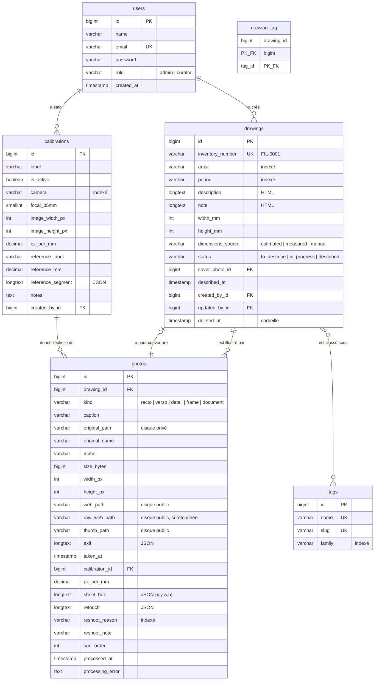

# Filigrane — schéma relationnel

**Moteur :** MariaDB 11.4 · **Encodage :** `utf8mb4_unicode_ci` · **Migrations :** `database/migrations/`

Écrit pour : un développeur reprenant le projet, ou toi dans six mois.

---

## Vue d'ensemble

*Le bloc ci-dessus fait foi. Pour les lecteurs dont l'outil n'interprète pas
Mermaid, la même chose en image :* [diagrammes/schema-base-de-donnees.svg](diagrammes/schema-base-de-donnees.svg)
*(régénérée par `node scripts/rendre-diagrammes.mjs`).*

---

## `drawings` — la fiche d'un dessin

C'est la table centrale. Une ligne par feuille de la collection.

| Colonne | Type | Null | Rôle |
|---|---|:-:|---|
| `id` | `bigint unsigned` | non | Clé primaire. |
| `inventory_number` | `varchar(32)` **unique** | non | Numéro attribué à la création (`FIL-0001`). Jamais recyclé. |
| `artist` | `varchar(255)` *indexé* | oui | Texte libre, volontairement non normalisé (voir plus bas). |
| `period` | `varchar(255)` *indexé* | oui | Texte libre : « vers 1750 », « XVIIIᵉ siècle », « daté 1783 ». |
| `description` | `longtext` | oui | HTML produit par l'éditeur enrichi. Ce que l'on voit. |
| `note` | `longtext` | oui | HTML. Hypothèses, provenance, questions en suspens. |
| `width_mm` / `height_mm` | `int unsigned` | oui | Dimensions de la feuille, en **millimètres entiers**. |
| `dimensions_source` | `varchar(20)` | oui | `estimated` (calculée depuis la photo), `measured` (relevée), `manual`. |
| `status` | `varchar(20)` *indexé* | non | `to_describe` → `in_progress` → `described`. |
| `cover_photo_id` | `bigint` FK → `photos` | oui | Photo servant de vignette. `ON DELETE SET NULL`. |
| `described_at` | `timestamp` | oui | Horodatage du passage en « décrit ». |
| `created_by_id`, `updated_by_id` | FK → `users` | oui | Qui a créé, qui a modifié en dernier. `ON DELETE SET NULL`. |
| `deleted_at` | `timestamp` | oui | Corbeille (*soft delete*). |

**Pourquoi des millimètres entiers et non des centimètres décimaux ?**
Parce que l'arithmétique sur des entiers ne dérive pas. Une dimension calculée
depuis une photo tombe naturellement sur un nombre de millimètres ; l'affichage
en centimètres se fait à la lecture (`Drawing::dimensionsLabel()`).

**Pourquoi `artist` en texte libre plutôt qu'une table d'auteurs ?**
Parce que les critères définitifs ne sont pas encore arrêtés et qu'une
collection de dessins anciens est pleine d'attributions incertaines :
« entourage de », « d'après », « anonyme, école française ». Une table
`artists` imposerait une identité là où il n'y a souvent qu'une hypothèse.
Le champ est indexé et proposé en autocomplétion à partir des valeurs déjà
saisies, ce qui limite les variantes orthographiques.
La bascule vers une table dédiée reste possible : voir la décision **D-07**.

**Pourquoi un `status` et non un simple booléen ?**
Parce que « commencé mais pas fini » est l'état le plus fréquent d'un
catalogage, et qu'il faut pouvoir retrouver ces fiches-là en priorité.

---

## `photos` — les prises de vue

Une fiche porte plusieurs photographies : recto, verso, détail d'une
inscription, filigrane vu par transparence, cadre.

| Colonne | Type | Null | Rôle |
|---|---|:-:|---|
| `drawing_id` | FK → `drawings` | non | `ON DELETE CASCADE`. |
| `kind` | `varchar(20)` | non | `recto`, `verso`, `detail`, `frame`, `document`. |
| `caption` | `varchar(255)` | oui | « Filigrane : raisin, visible par transparence ». |
| `original_path` | `varchar(255)` | non | Chemin sur le **disque privé**. Le fichier d'origine, octet pour octet. |
| `original_name` | `varchar(255)` | oui | Nom du fichier tel que déposé, pour la traçabilité. |
| `mime`, `size_bytes` | | oui | Renseignés à l'import. |
| `width_px`, `height_px` | `int unsigned` | oui | Définition de l'**original**, pas du dérivé. Base de tout calcul d'échelle. |
| `web_path`, `thumb_path` | `varchar(255)` | oui | Dérivés JPEG sur le disque public, servis en statique par Apache. Retouchés si la photo l'est. |
| `raw_web_path` | `varchar(255)` | oui | Version web d'avant retouche, gardée pour reprendre la retouche. Null si la photo n'est pas retouchée. |
| `exif` | `longtext` (JSON) | oui | `camera`, `focal_35mm`, `subject_distance_mm`, `taken_at`, `iso`… |
| `taken_at` | `timestamp` | oui | Extrait de l'EXIF, utile pour reconstituer une séance. |
| `calibration_id` | FK → `calibrations` | oui | Profil d'échelle appliqué. `ON DELETE SET NULL`. |
| `px_per_mm` | `decimal(12,6)` | oui | Nombre de pixels par millimètre réel sur cette photo. |
| `sheet_box` | `longtext` (JSON) | oui | Rectangle de la feuille, en coordonnées **normalisées** `{x, y, w, h}` ∈ [0,1]. Sur une photo retouchée, se rapporte à l'image redressée. |
| `retouch` | `longtext` (JSON) | oui | Réglages de retouche : `coins`, `quart`, `focale`, `luminosite`, `contraste`, et la définition du rectangle redressé (`largeur_px`, `hauteur_px`). Voir **D-36**. |
| `reshoot_reason` | `varchar(20)` *indexé* | oui | Cliché à refaire : `reflections`, `blur`, `dark`, `framing`, `other`. Null : le cliché convient. Voir **D-38**. |
| `reshoot_note` | `varchar(255)` | oui | Précision libre sur le défaut : « reflet de la fenêtre en haut à gauche ». |
| `sort_order` | `int unsigned` | non | Ordre d'affichage, réorganisable à la souris. |
| `processed_at` | `timestamp` | oui | Null tant que les dérivés ne sont pas fabriqués. |
| `processing_error` | `text` | oui | Message d'échec, conservé pour diagnostic. |

**Pourquoi des coordonnées normalisées pour `sheet_box` ?**
Parce qu'elles restent valables quelle que soit la taille à laquelle l'image
est affichée. L'outil de mesure travaille sur la version web de 2 400 px, le
calcul se fait sur l'original de 3 000 px ou plus : sans normalisation, il
faudrait traîner un facteur d'échelle partout.

**Pourquoi conserver l'original sur un disque privé ?**
Les dérivés sont servis directement par Apache, à des adresses impossibles à
deviner mais publiques. Les originaux, eux — la seule copie de référence de ces
œuvres — passent par une route authentifiée (`/photos/{photo}/original`).
Voir la décision **D-05**.

---

## `calibrations` — les profils d'échelle

C'est la table qui rend la mesure automatique possible sur 250 dessins.

Une calibration répond à une question : *sur les photos de cette séance,
combien de pixels vaut un millimètre réel ?* Elle est établie une seule fois,
en photographiant une règle ou une carte bancaire à côté du dessin, puis
réutilisée sur toutes les photos prises dans les mêmes conditions.

| Colonne | Rôle |
|---|---|
| `label` | « Séance du 28 octobre, trépied à 1,20 m ». |
| `is_active` | Un profil inactif n'est plus appliqué automatiquement. |
| `camera`, `focal_35mm`, `image_width_px`, `image_height_px` | **Signature de la série.** Les quatre doivent correspondre pour qu'un profil s'applique. |
| `px_per_mm` | Le résultat. |
| `reference_label`, `reference_mm`, `reference_segment` | Trace de la mesure d'origine : quel objet, quelle longueur, quel segment tracé. Permet de refaire le calcul ou de le contester. |

**Pourquoi quatre critères de correspondance et pas un seul ?**
Parce que l'échelle dépend de la distance de prise de vue. Changer d'appareil,
de focale ou de cadrage signifie presque toujours que la distance a changé
aussi. Mieux vaut ne rien mesurer que mesurer faux : une dimension erronée dans
un catalogue y reste des années.

---

## `tags` et `drawing_tag` — le classement libre

| Colonne | Rôle |
|---|---|
| `tags.name` | Unique. « Paysage », « École française », « Carton 3 ». |
| `tags.slug` | Dérivé automatiquement du nom. |
| `tags.family` | Regroupement facultatif : `sujet`, `école`, `emplacement`, `provenance`. |

La table pivot `drawing_tag` a une clé primaire composite `(drawing_id, tag_id)` :
un même mot-clé ne peut pas être posé deux fois sur la même fiche.

**Pourquoi des mots-clés plutôt que des colonnes dédiées ?**
Parce que les critères de classement ne sont pas encore arrêtés. Les mots-clés
se créent au fil de l'eau, sans migration ; le champ `family` permet de les
ranger quand ils se multiplient. Si un critère s'impose durablement, il pourra
devenir une colonne : voir la décision **D-08**.

L'emplacement physique (carton nº, mur) passe aussi par les mots-clés, par
choix explicite — voir **D-09**.

---

## `users` — les comptes

Deux comptes nominatifs, créés à la main. Pas d'inscription ouverte.

| `role` | Droits |
|---|---|
| `curator` | Consulter, créer, décrire, photographier, classer, mettre à la corbeille. |
| `admin` | Idem, plus : gestion des comptes, profils d'échelle, suppression définitive. |

Les règles sont écrites dans `app/Policies/` et non dans l'interface : un accès
direct par URL est refusé de la même façon qu'un bouton masqué.

---

## Tables techniques

`migrations`, `sessions`, `cache`, `cache_locks`, `jobs`, `job_batches`,
`failed_jobs`, `password_reset_tokens` : fournies par Laravel.

Les sessions sont en base (et non en fichier) pour que la déconnexion soit
immédiate sur tous les appareils et que la durée de 30 jours survive aux
nettoyages de `/tmp` de l'hébergeur.

---

## Ce que le schéma ne contient pas, volontairement

| Absent | Pourquoi | Où c'est discuté |
|---|---|---|
| Table `artists` | Les attributions sont incertaines par nature. | D-07 |
| Table `locations` | Les mots-clés suffisent tant que le classement n'est pas arrêté. | D-09 |
| Historique des modifications | Deux utilisateurs, pas de conflit d'édition attendu. | D-10 |
| Index *full-text* | 250 fiches : une recherche `LIKE` répond en quelques millisecondes. | D-11 |
| File d'attente active | Les images sont traitées pendant la requête d'envoi. | D-03 |
