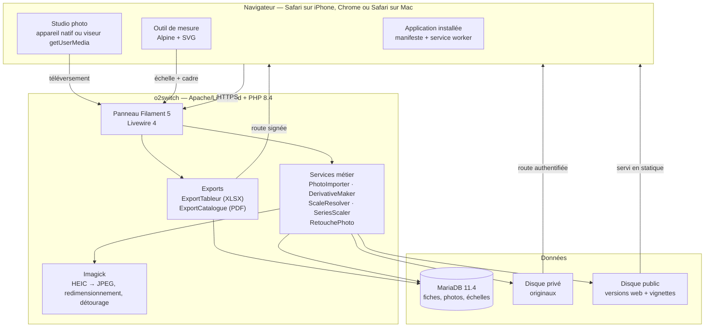
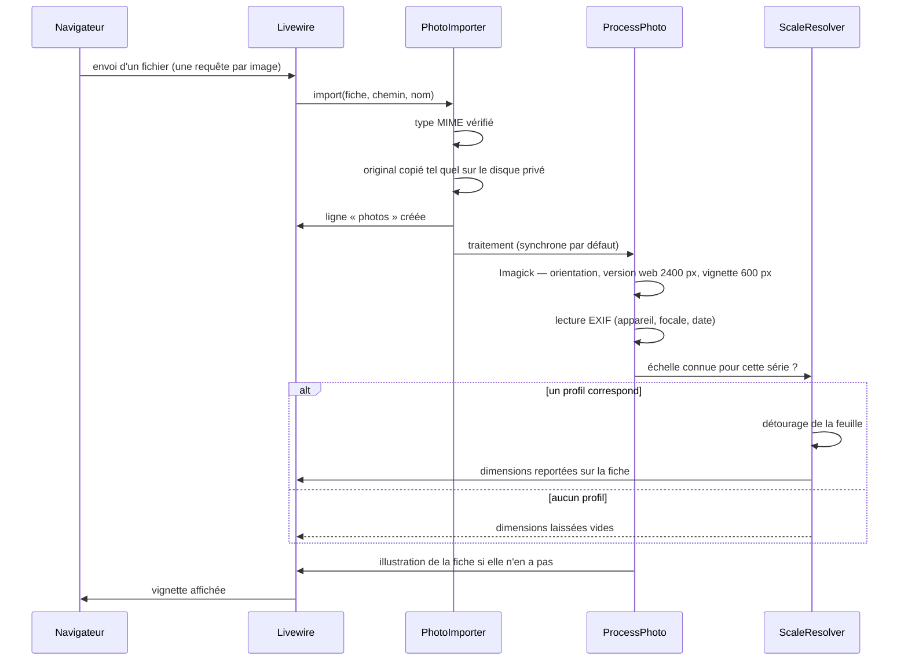
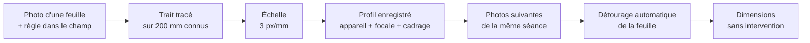
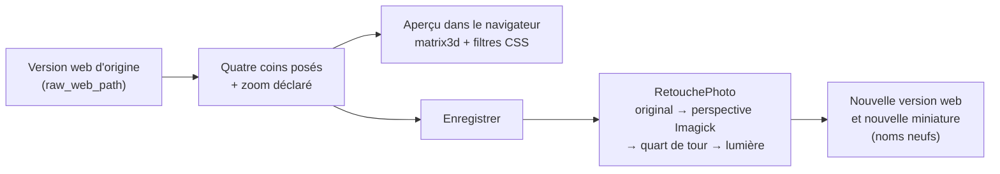

# Filigrane — architecture technique

Écrit pour : un développeur qui doit faire évoluer, dépanner ou reprendre
l'application.

---

## En une page

Filigrane est une application Laravel servie par Apache, avec une interface
construite sur Filament. Elle s'installe sur l'écran d'accueil d'un iPhone et
dans le Dock d'un Mac grâce à un manifeste et à un service worker minimal.
Elle exige une connexion : rien n'est mis en file d'attente hors ligne.

Deux personnes l'utilisent : l'une photographie, l'autre décrit.



---

## Le choix structurant : où vit le code

Le code de l'application ne se trouve **pas** dans le dossier web.

```
/home/<compte>/
├── apps/filigrane/          ← l'application (hors du web)
│   ├── app/ config/ vendor/
│   ├── .env                 ← identifiants
│   └── storage/app/
│       ├── private/photos/  ← les originaux
│       └── public/photos/   ← versions web et vignettes
├── filigrane.exemple.fr/    ← racine web
│   ├── index.php            ← réécrit à chaque déploiement
│   ├── .htaccess
│   ├── build/ icones/
│   └── storage → ../apps/filigrane/storage/app/public
└── sauvegardes/
```

Sur un hébergement mutualisé, la racine web d'un sous-domaine est un dossier
imposé. Beaucoup de déploiements Laravel y placent le projet entier et comptent
sur `.htaccess` pour empêcher d'atteindre `.env`. Une règle qui saute lors
d'une migration d'hébergeur, et les identifiants de la base deviennent
publics. Ici, il n'y a rien à protéger : les fichiers sensibles ne sont pas
sous la racine web, un point c'est tout.

Le prix à payer : `public/index.php` doit pointer ailleurs que vers son dossier
parent. `scripts/deployer.sh` le réécrit à chaque mise en ligne.

---

## Pile logicielle

| Couche | Choix | Version | Remarque |
|---|---|---|---|
| Serveur web | Apache (LiteSpeed en production) | — | `.htaccess` identique en local et en ligne. |
| PHP | 8.4.27 | identique en dev et en ligne | `config.platform` dans `composer.json` fige la résolution sur 8.4. |
| Framework | Laravel | 13.x | |
| Interface | Filament | 5.11 | Livewire 4, Alpine, Tailwind 4. |
| Base | MariaDB | 11.4 | Même version en local (image Docker) qu'en ligne. |
| Images | Imagick + Intervention Image | 4.4 | **Imagick obligatoire** : GD ne lit pas le HEIC. |
| Export tableur | openspout | 4.x | Écriture en flux : la mémoire ne dépend pas du nombre de lignes. |
| Export PDF | dompdf | 3.x | PHP pur : aucun navigateur sans tête à installer sur le mutualisé. |
| Tests | PHPUnit 12 · Playwright | | |

Le développement tourne dans Docker avec exactement les mêmes versions de PHP
et de MariaDB que l'hébergement. Ce n'est pas du zèle : un décalage de version
sur Imagick ou sur les colonnes JSON se paie à la mise en ligne, c'est-à-dire
au pire moment.

---

## Le trajet d'une photographie



### Pourquoi un traitement synchrone

Les dérivés sont fabriqués **pendant la requête d'envoi**, pas en file
d'attente. Cela semble contre-intuitif pour un import de 200 photographies,
mais :

- Livewire envoie **un fichier par requête HTTP**. Chaque requête ne traite
  donc qu'une image, soit une à deux secondes, loin des 600 secondes
  autorisées par l'hébergeur.
- L'import en masse enchaîne volontairement une requête par image
  (`ImportEnMasse::suivant()`), ce qui donne une barre de progression honnête
  au lieu d'une attente opaque.
- Une file d'attente sur un hébergement mutualisé suppose un *worker* lancé par
  cron, donc jusqu'à soixante secondes avant qu'une vignette apparaisse. Pour
  quelqu'un qui photographie dessin après dessin, c'est inacceptable.

La bascule reste à un réglage près : `FILIGRANE_IMAGE_PROCESSING=queue` dans
`.env` et un worker en cron. Voir la décision **D-03**.

---

## La mesure des dimensions

C'est la partie la moins évidente de l'application, et celle qui a demandé le
plus de soin.

**Le problème.** On ne peut pas déduire la taille réelle d'un objet d'une
photographie seule. Il y manque une information : la distance de prise de vue,
ou une longueur connue dans le champ. Les iPhone n'enregistrent pas de façon
fiable la distance de mise au point dans l'EXIF.

**La solution retenue.** Une calibration par référence visuelle, faite une
seule fois par séance de prise de vue :

1. On photographie **un** dessin avec une règle ou une carte bancaire posée à
   côté.
2. Dans l'outil « Mesurer », on tire le trait rouge sur la référence et on
   déclare sa longueur. L'application en déduit une échelle, en pixels par
   millimètre.
3. On ajuste le cadre bleu sur la feuille. Il est pré-positionné par détourage
   automatique (`SheetDetector`), qui fonctionne dès que le fond est uni et
   contrasté.
4. On coche « enregistrer cette échelle comme profil ».

À partir de là, **toute photographie prise dans les mêmes conditions** — même
appareil, même focale équivalente, même définition — reçoit automatiquement
cette échelle, et ses dimensions sont calculées sans intervention.

> **La quatrième étape est facultative, et c'est important.** La case est
> décochée par défaut. Le profil n'est pas le mécanisme de la mesure, c'est un
> raccourci pour une séance où rien ne bouge. Dès lors que la référence figure
> dans chaque photographie — le cas des œuvres encadrées au mur, qu'on ne
> photographie jamais deux fois à la même distance —, chaque image porte sa
> propre échelle et la distance n'a plus d'importance. Le mode d'emploi de
> terrain est dans [08 — Guide de prise de vue](08-prise-de-vue.md).



**Les garde-fous.**

- Trois critères doivent correspondre pour qu'un profil s'applique. Si l'un
  change, l'échelle n'est pas appliquée : mieux vaut aucune dimension qu'une
  dimension fausse dans un catalogue.
- Une dimension calculée est marquée « estimée ». Une dimension saisie à la
  main ou relevée au mètre n'est **jamais** écrasée par un calcul.
- Le détourage échoue proprement (il renvoie `null`) quand le fond n'est pas
  uni ; le cadre reste alors ajustable à la main.

**La précision obtenue.** Sur les images de test — une feuille de 300 × 400 mm
photographiée à 3 px/mm — la chaîne complète retrouve 301 × 401 mm, soit 0,3 %
d'écart, dû à la réduction à 1 400 px pendant le détourage. Largement suffisant
pour un catalogue ; insuffisant pour un constat d'état.

**Une voie secondaire** existe : si l'EXIF contient la focale équivalente 35 mm
**et** la distance du sujet, l'échelle est estimée sans référence
(`ScaleResolver::estimateFromExif()`). En pratique les iPhone fournissent
rarement la seconde, donc cette voie reste un bonus — et les photos prises
depuis Filigrane n'ont, de fait, aucun EXIF hormis l'orientation.

---

## La retouche

Les œuvres encadrées se photographient au mur, souvent d'en bas : elles
arrivent en trapèze, entourées de mur et de cadres voisins. La page
`RetoucherPhoto` (`/retoucher?photo=…`) les redresse.



**Les réglages, pas l'image.** La colonne `retouch` retient les coins
(normalisés sur l'image orientée), le quart de tour, la focale, la luminosité,
le contraste, et la définition du rectangle redressé rapportée à la pleine
résolution. L'image est refabriquée depuis l'**original** — pas depuis la
version web, pour ne rien perdre en recadrant. Voir
[D-36](04-decisions-et-alternatives.md#d-36).

**Les proportions.** `App\Support\Perspective::proportions()` calcule le vrai
rapport largeur / hauteur du rectangle photographié, à partir des coins et de
la focale (méthode de Zhang et He). Le même calcul est réécrit en JavaScript
dans la page, pour l'aperçu. Voir [D-37](04-decisions-et-alternatives.md#d-37).

**Le rendu.** `Imagick::distortImage(DISTORTION_PERSPECTIVE)` envoie les quatre
coins sur un rectangle aux dimensions de la version web, directement — on ne
fabrique pas une image pleine définition pour la réduire ensuite. La lumière
est un polynôme du premier degré (`functionImage`), identique aux filtres CSS
de l'aperçu. Compter moins d'une seconde par photographie.

**Ce qui en dépend.**

| Élément | Comportement sur une photographie retouchée |
|---|---|
| Version web, miniature | Retouchées, sous un nom neuf (le cache du navigateur dure un an). |
| Diaporama, catalogue PDF, planche | Suivent, puisqu'ils lisent la version web. |
| Lien « Pleine résolution » | Toujours l'original, sans retouche. |
| Outil de mesure | Travaille sur l'image redressée : `Photo::workingSize()` donne sa définition. |
| Mesure déjà faite | Effacée si la géométrie change ; les dimensions de la fiche restent. |
| Profils d'échelle | Ne s'appliquent plus (`SeriesScaler::candidates()` l'exclut). |

### Les clichés à refaire

Un cliché raté n'est pas supprimé : il suffit à décrire l'œuvre en attendant
le nouveau. On le signale (`reshoot_reason`, `reshoot_note`) depuis la liste
des photographies de la fiche. Le signalement s'affiche sous la photographie,
sur la vignette de la planche, et réunit les fiches concernées dans l'onglet
« À rephotographier » (`Drawing::scopeNeedsReshoot()`). Voir
[D-38](04-decisions-et-alternatives.md#d-38).

---

## Stockage des images

| | Original | Version web | Vignette |
|---|---|---|---|
| Disque | privé (`storage/app/private`) | public | public |
| Format | tel quel (HEIC, JPEG, TIFF…) | JPEG progressif | JPEG |
| Taille | inchangée | 2 400 px de large au plus | 600 × 600 |
| Accès | route authentifiée `/photos/{id}/original` | statique, par Apache | statique, par Apache |

L'original est l'unique copie de référence de l'œuvre : il n'est jamais
recompressé ni réorienté. Les dérivés, eux, sont jetables — ils se
reconstruisent à partir de l'original.

Une photographie retouchée garde en plus sa **version web d'origine**
(`raw_web_path`) : c'est sur elle que l'outil replace les coins. Environ 1 Mo
de plus par photographie retouchée.

Les noms de fichiers sont des ULID : impossibles à deviner, triables par date
de création.

**Ordre de grandeur.** 250 dessins, 400 photographies de 12 Mpx : environ
1,5 Go d'originaux, 150 Mo de dérivés.

---

## Application installable (PWA)

| Élément | Rôle |
|---|---|
| `public/manifest.webmanifest` | Nom, icônes, couleurs, raccourcis « À décrire » et « Studio photo ». |
| `public/sw.js` | Rend l'application installable et affiche une page lisible sans réseau. |
| `resources/views/pwa/head.blade.php` | Balises iOS, icônes, enregistrement du service worker. |

Le service worker est volontairement minimal : il ne met en cache que la page
hors-ligne et les icônes. Il ne touche jamais aux requêtes `POST` — rejouer un
enregistrement depuis un cache corromprait une fiche. Et il ne met en cache
aucune photographie : 250 dessins dépasseraient vite le quota accordé à Safari
sur iOS.

**Installation.** Sur iPhone : Safari → Partager → « Sur l'écran d'accueil ».
Sur Mac : Chrome → icône d'installation dans la barre d'adresse, ou Safari →
Fichier → « Ajouter au Dock ».

---

## Accessibilité et confort

L'utilisatrice principale a plus de quatre-vingt-dix ans. Ce n'est pas une
contrainte parmi d'autres,
c'est **la** contrainte de conception.

| Mesure | Mise en œuvre |
|---|---|
| Corps de texte à 17 px, contre 16 par défaut | `html { font-size: 17px }` dans le thème. |
| Cibles tactiles d'au moins 44 px | Vérifié automatiquement (`08-confort.spec.js`). |
| Contraste du bouton principal | 6,5:1 mesuré, au-delà du seuil AA de 4,5:1. |
| Fenêtres de confirmation explicites | « Mettre à la corbeille » ne dit pas « Supprimer ». |
| Interface entièrement en français | 168 clés manquantes dans Filament 5.11 ont été traduites (`lang/vendor/`). |

> Un réglage « A− / A+ » avait d'abord été posé dans la barre supérieure. Il a
> été **retiré** : l'utilisatrice voit très bien, et deux boutons inutiles en
> permanence sous les yeux coûtent plus qu'ils ne rapportent. Voir
> [D-18](04-decisions-et-alternatives.md#d-18) — ce qui reste, c'est la base à
> 17 px, qui ne gêne personne.

---

## Lecture suivie et exports

Trois façons de ressortir le travail une fois les fiches décrites.

### Le diaporama (`/diaporama`)

`App\Filament\Pages\Diaporama` rassemble les fiches **commentées et
photographiées** (`Drawing::scopeCommented()`, puis `TexteRiche::estVide()`
pour les champs que l'éditeur a laissés à `<p></p>`) et les envoie en une fois
au navigateur. Alpine les feuillette sans aller-retour ; seules les images se
chargent à la demande, la voisine suivante et la précédente d'abord.

Clavier (← →, espace), balayage du doigt, défilement automatique et plein
écran. Voir [D-30](04-decisions-et-alternatives.md#d-30).

### Les deux exports

| | Tableur | Catalogue |
|---|---|---|
| Format | XLSX (*openspout*) | PDF A4 (*dompdf*) |
| Images | non | oui, une page par dessin |
| Dimensions | nombres, en millimètres | texte, « 40,1 × 30,1 cm » |
| Service | `App\Services\ExportTableur` | `App\Services\ExportCatalogue` |
| Gabarit | — | `resources/views/exports/catalogue.blade.php` |

Les deux suivent **ce que la liste affiche** : `getFilteredTableQuery()`,
donc l'onglet ouvert, les filtres posés et la recherche en cours.

**Le chemin du fichier.** L'action ne retourne pas le fichier : Livewire
l'encoderait en base64 dans sa réponse JSON. Elle l'écrit dans
`storage/app/private/exports/`, puis redirige vers une route signée
(`exports.telecharger`, dix minutes) qui le diffuse et l'efface après remise.
Les exports abandonnés sont balayés chaque nuit par `filigrane:menage`. Voir
[D-32](04-decisions-et-alternatives.md#d-32).

**Les images du PDF** sont refabriquées à 1 200 px dans un dossier temporaire :
le dérivé web (2 400 px) donnerait un fichier de 200 Mo, et la miniature est
recadrée au carré. Compter environ 30 Mo pour 250 planches. Voir
[D-33](04-decisions-et-alternatives.md#d-33).

### `App\Support\TexteRiche`

Point de passage obligé de tout texte riche réaffiché hors de l'éditeur :
réduit le balisage aux balises que l'éditeur produit, assainit les `href`,
rend `''` pour un champ sans texte, et sait convertir en texte brut pour une
cellule de tableur.

---

## Présentation publique

`/a-propos` est la seule page lisible sans compte. Elle présente le projet et
crédite l'auteur ; elle ne montre **aucune donnée réelle** — les trois aperçus
sont pris sur le jeu d'essai (`filigrane:jeu-d-essai`, puis `make apercus`), et
un test vérifie qu'aucun numéro d'inventaire n'y figure.

Elle a sa propre feuille de style, `resources/css/app.css` : le thème Filament
ne sert qu'au panneau.

---

## Organisation du code

```
app/
├── Console/Commands/     filigrane:compte, :sauvegarder, :menage, :jeu-d-essai
├── Enums/                DrawingStatus, PhotoKind, DimensionsSource, UserRole,
│                         ReshootReason
├── Filament/
│   ├── Pages/            StudioPhoto, ImportEnMasse, MesurerPhoto,
│   │                     RetoucherPhoto, Diaporama
│   ├── Resources/        Drawings, Tags, Calibrations, Users
│   └── Widgets/          CollectionProgress, LatestDrawings
├── Http/Controllers/     PhotoFileController (originaux authentifiés)
│                         ExportFileController (remise d'un export)
├── Jobs/                 ProcessPhoto
├── Livewire/             VisionneusePhotos
├── Models/               Drawing, Photo, Tag, Calibration, User
├── Observers/            DrawingObserver, PhotoObserver
├── Policies/             une par modèle
├── Services/             PhotoImporter, DerivativeMaker, ScaleResolver,
│                         SeriesScaler, InventoryNumberGenerator,
│                         ExportTableur, ExportCatalogue, RetouchePhoto
└── Support/              ExifReader, SheetDetector, TexteRiche, Perspective
```

**Pourquoi un composant Livewire séparé pour le panneau d'images ?**
Parce qu'il doit se redessiner quand une photographie est ajoutée, sans
rafraîchir le formulaire — ce qui effacerait la description en cours de frappe.

**Pourquoi des observateurs plutôt que du code dans les contrôleurs ?**
Parce que les règles concernées (numéro d'inventaire, horodatage, suppression
des fichiers) doivent valoir quelle que soit la porte d'entrée : interface,
ligne de commande, import en masse ou test.

---

## Tests

| Suite | Quantité | Ce qu'elle couvre |
|---|---|---|
| PHPUnit (`tests/Feature`) | 57 tests | Numérotation, chaîne de traitement des images, échelles, corbeille, exports, retouche et proportions, clichés à refaire, avancement automatique et par lots. |
| Playwright `mac` | 55 tests | Connexion, droits, catalogage et avancement par lots, import, studio, mesure, retouche, clichés à refaire, PWA, confort, diaporama, exports. |
| Playwright `mobile` | 16 tests | Mise en page et atteignabilité à 390 px, retouche comprise. |
| Playwright `en-ligne` | 1 test | Recette du serveur réel après déploiement. |

Les tests tournent contre **MariaDB**, pas SQLite : le schéma interroge des
colonnes JSON par chemin (`exif->camera`), et la traduction SQL diffère d'un
moteur à l'autre. Un test vert sur SQLite ne prouverait rien.

Huit défauts réels ont été trouvés par ces tests plutôt que par l'usage :

1. `SheetDetector` lisait la taille du canevas au lieu de celle de la zone
   détourée — toute détection échouait.
2. Ouvrir une fiche mise à la corbeille provoquait une erreur 500 : la relation
   `Photo → Drawing` renvoyait `null`.
3. La suppression définitive passait par la cascade SQL, laissant les fichiers
   image orphelins sur le disque.
4. L'export tableur numérotait ses colonnes à partir de 0 alors qu'openspout
   les attend à partir de 1 : le `.xlsx` produit avait une taille plausible et
   refusait de s'ouvrir. Relire le fichier avec le lecteur de la même
   bibliothèque est le seul moyen d'attraper cela.
5. Un champ riche seulement effleuré est enregistré « `<p></p>` » : un bloc
   « Note » vide apparaissait dans le diaporama et dans le catalogue.
6. Le middleware `auth` de Laravel cherche une route nommée `login` pour y
   renvoyer les visiteurs ; Filament nomme la sienne
   `filament.admin.auth.login`. Les routes hors panneau — photographies
   d'origine, remise d'un export — répondaient donc **500** à un visiteur non
   connecté au lieu de rediriger. Corrigé par `redirectGuestsTo('/login')`
   dans `bootstrap/app.php`.
7. **Le plus coûteux.** Le script de déploiement excluait `vendor` sans
   ancrer le motif : rsync exclut alors *tout* dossier de ce nom, `lang/vendor`
   compris. Les 168 traductions françaises n'avaient jamais été mises en
   ligne, et l'interface affichait des identifiants bruts
   (`filament-panels::layout.topbar.label`) — invisible depuis le poste de
   développement, où elles sont bien là. Le motif est maintenant `/vendor`, et
   deux contrôles veillent : `verifier-production.sh` et la recette en ligne
   échouent si une clé brute réapparaît.
8. Filament pose la classe `dark` sur `<html>`, et non sur `<body>`. Une règle
   écrite `.fi-body:not(.dark)` était donc **toujours vraie** : le crème du
   thème clair se peignait jusque dans le thème sombre, et le logo — qui n'a
   pas de tuile — y faisait une vignette blanche sur la barre. Les deux sont
   corrigés, et un test joué en `colorScheme: 'dark'` interroge désormais la
   règle CSS elle-même plutôt que la visibilité, la barre latérale étant
   repliée sur un téléphone.

Un neuvième, trouvé en écrivant l'outil de retouche et non par un test — ce
qui dit bien la limite d'un test qui partage l'erreur qu'il devrait voir :

9. Dans l'outil de mesure, la photographie était posée dans un cadre à marge
   intérieure de 8 px, et les pastilles se repéraient sur ce cadre, pas sur
   l'image. Une pastille posée sur le coin de la feuille désignait donc un
   point légèrement décalé, soit environ 1 % d'erreur sur les dimensions. Le
   test de bout en bout visait le même cadre et ne pouvait rien voir. La scène
   épouse désormais l'image, et le test vise la scène. Au passage, sa hauteur
   est bornée à l'écran : sur un Mac, une photographie en hauteur cachait le
   bas de la feuille sous la ligne de flottaison.

Un dixième, trouvé à l'usage, cousin du cinquième :

10. Une fiche « à décrire » passe d'elle-même « en cours » quand on y écrit un
    artiste ou une description. La règle testait `filled()`, et « `<p></p>` »
    est rempli : un simple clic dans la description suffisait. Pire, elle
    s'appliquait aussi quand on venait de remettre la fiche à décrire à la
    main, si bien qu'on ne pouvait plus l'y ramener. La règle lit désormais le
    texte par `TexteRiche`, ne joue que si l'avancement n'a pas été changé à la
    main, et seulement si l'artiste ou la description viennent d'être écrits
    (`AvancementTest`).

Un onzième, trouvé en regardant une capture du changement d'avancement par
lots, et non par le test qui le couvrait — le test cochait, comptait, et ne
regardait pas :

11. Pour détacher la case à cocher de l'image, le thème lui donnait un fond
    blanc, y compris une fois cochée. La coche de Filament est blanche : sur
    les vignettes, une case cochée ne se distinguait plus d'une case vide.
    Cela durait depuis la mise en planche, sans gêner tant que la sélection
    ne servait qu'à la corbeille. Le fond blanc ne vaut plus que pour une case
    vide, une vignette cochée s'entoure d'un trait sanguine, et le test vérifie
    désormais la couleur de la case.

Un douzième, signalé à l'usage le lendemain :

12. Après un changement d'avancement par lots, les compteurs des onglets ne
    bougeaient pas avant un changement de page. Filament construit les
    onglets au début de la requête, avant l'action, et les compteurs étaient
    calculés à ce moment-là. Ce sont désormais des fonctions, évaluées à
    l'affichage. Le compteur « Dessins » du menu de gauche, qui vit dans un
    autre composant, reçoit le signal `refresh-sidebar` après chaque action
    par lots. Le test de bout en bout vérifie les deux sans recharger la page.

**Ce que les tests ne couvrent pas, et qu'il faut vérifier à la main :**

- **Safari sur un vrai iPhone.** Chromium à 390 px vérifie la mise en page, pas
  le comportement de Safari : accès caméra en mode installé, gestion du HEIC,
  clavier qui recouvre un champ. Essayé à la main le 29 octobre sur la
  tablette, le téléphone et le Mac de l'utilisatrice : rien à signaler.
- **La conversion HEIC.** ImageMagick sait lire ce format mais pas l'écrire :
  impossible de fabriquer une image de test. Déposez une vraie photo d'iPhone
  dans `tests/fixtures/dessin-iphone.heic` et le test dédié s'activera.
- **La qualité d'une vraie mesure**, sur un vrai dessin, avec une vraie règle.
- **Les proportions d'une vraie œuvre redressée.** Le test prouve le calcul sur
  un appareil simulé ; reste à le confronter à un cadre de dimensions connues,
  photographié d'en bas.
- **Le glisser des pastilles au doigt, dans Safari.** Chromium vérifie que les
  pastilles sont dans l'écran et assez grandes, pas que le geste est agréable.
  Essayé à la main le 29 octobre, en ligne, sur le Mac et sur le téléphone :
  concluant.

---

## Environnement de développement

```bash
make install     # première fois : image, base, dépendances, icônes, tests
make up          # http://localhost:8080
make test        # PHPUnit + Playwright
```

Comptes de développement : `lise@filigrane.test` et `emmanuel@filigrane.test`,
mot de passe `filigrane`.

Trois conteneurs : `app` (Apache + PHP 8.4 + Imagick), `db` (MariaDB 11.4),
`mailpit` (courriels sortants, sur <http://localhost:8025>).

**La caméra en local.** `getUserMedia` exige un contexte sécurisé.
`http://localhost` en est un, donc le viseur fonctionne sur le Mac. Depuis un
iPhone pointant sur l'IP du Mac en `http://`, il ne fonctionnera **pas** :
utilisez la version en ligne, qui est en HTTPS.

---

## Limites connues

| Limite | Conséquence | Contournement |
|---|---|---|
| `max_file_uploads = 20` chez l'hébergeur | Un formulaire HTML classique plafonnerait à 20 fichiers. | Livewire envoie un fichier par requête : sans objet ici. |
| Pas de mode hors-ligne | Sans réseau, on ne peut ni consulter ni saisir. | Choix assumé (D-02). |
| Pas de réinitialisation de mot de passe par courriel | Un oubli demande une intervention. | `php artisan filigrane:compte` en SSH, ou l'écran « Comptes ». |
| Cinq tentatives de connexion par minute | Un essai répété bloque une minute. | Protection voulue ; elle se réinitialise seule. |
| Détourage limité aux fonds unis | Sur un fond chargé, le cadre doit être ajusté à la main. | Photographier sur un carton neutre. |
