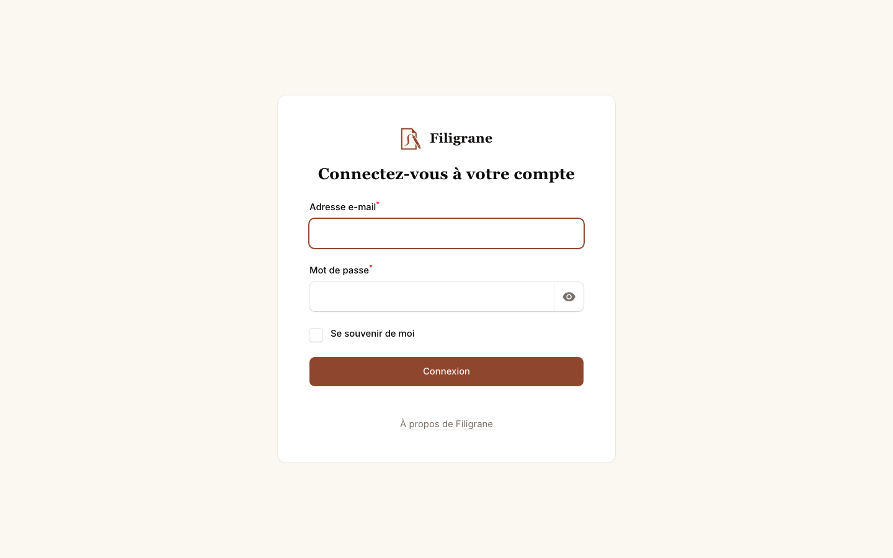
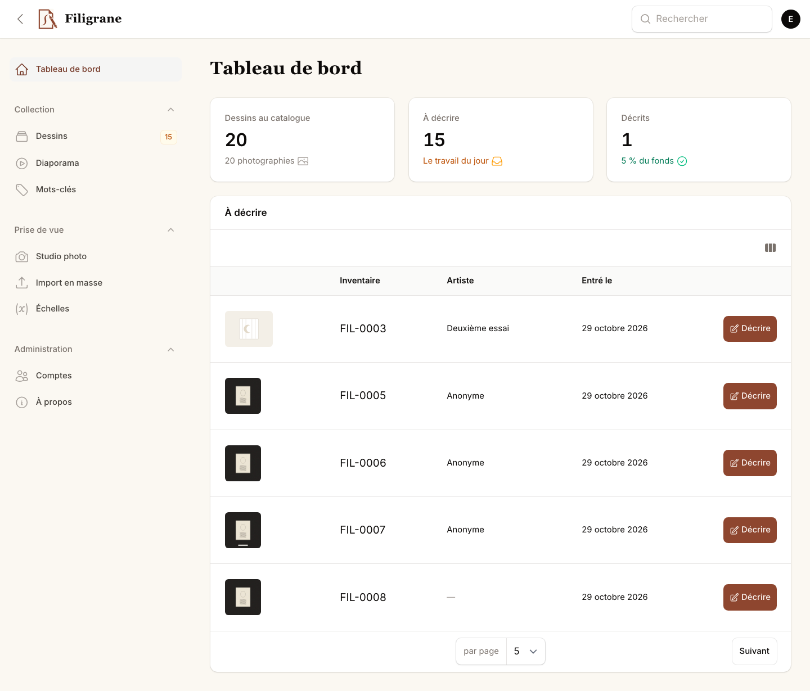
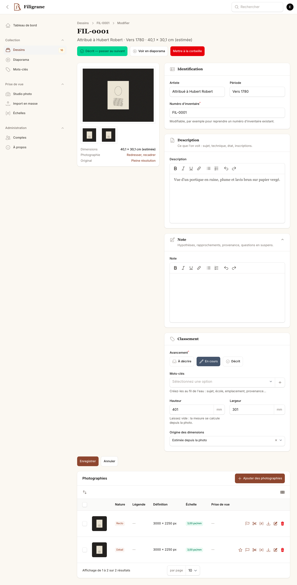
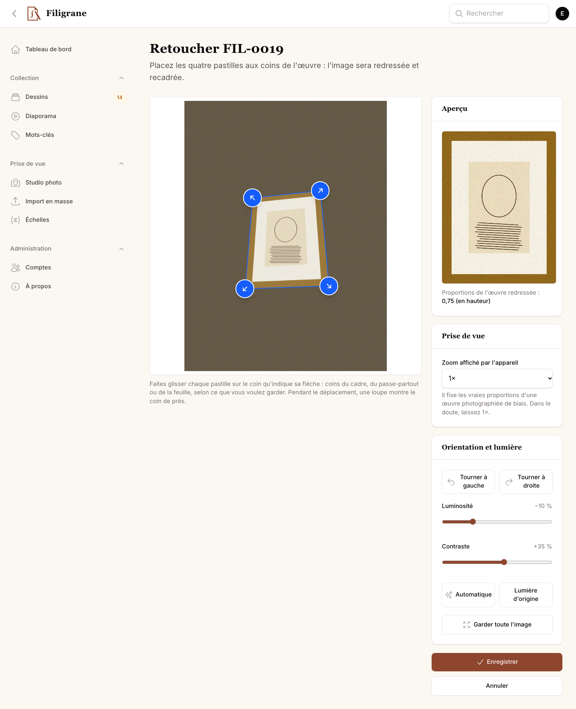
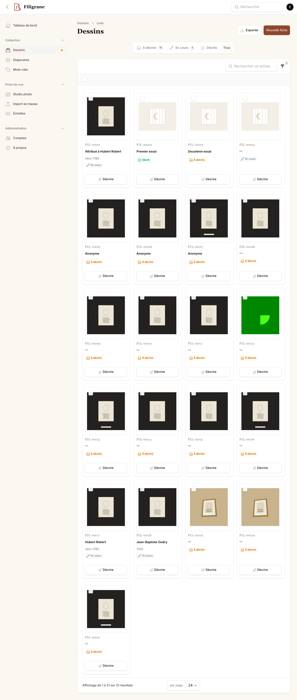
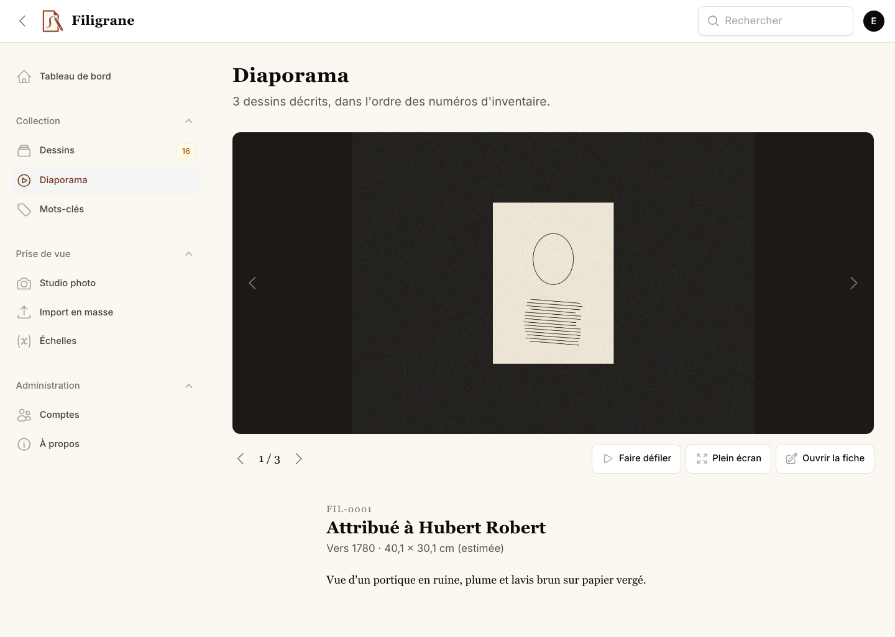
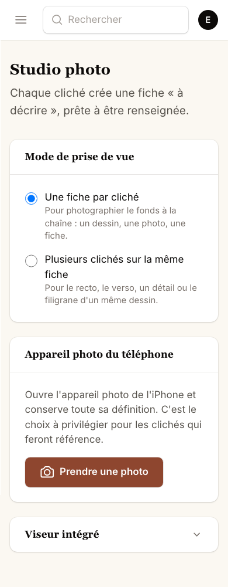

# Filigrane — guide d'utilisation

*Pour décrire et classer la collection de dessins.*

---

## Ce que fait Filigrane

Chaque dessin de la collection a sa **fiche**. Une fiche réunit les
photographies du dessin et ce que vous en écrivez : l'artiste, la période, la
description, vos notes.

Les photographies sont prises à l'avance. Vous n'avez donc qu'à ouvrir une
fiche, regarder le dessin à l'écran, et écrire.

L'application garde tout au fur et à mesure. Il n'y a rien à installer sur
l'ordinateur, rien à sauvegarder, rien à ranger.

Quand une partie de la collection est décrite, vous pouvez la **regarder en
diaporama** ou l'**emporter** — en tableur ou en catalogue PDF. Ces deux
chapitres sont plus bas.

---

## Ouvrir Filigrane

L'adresse est : **lise.dananlab.fr**

Pour ne plus avoir à la taper, posez l'application sur votre écran d'accueil ou
sur votre Dock. Elle s'ouvrira alors comme n'importe quelle autre application.

### Sur l'iPhone

1. Ouvrez **Safari** et allez à `lise.dananlab.fr`.
2. Touchez le bouton **Partager** — le carré avec une flèche vers le haut, en
   bas de l'écran.
3. Faites défiler et touchez **« Sur l'écran d'accueil »**.
4. Touchez **Ajouter**, en haut à droite.

L'icône de Filigrane est maintenant sur votre écran d'accueil.

### Sur le Mac

1. Ouvrez **Safari** et allez à `lise.dananlab.fr`.
2. Dans le menu **Fichier**, choisissez **« Ajouter au Dock »**.

*(Avec Chrome : cliquez sur l'icône d'installation à droite de la barre
d'adresse.)*

---

## Se connecter

Entrez votre adresse et votre mot de passe, puis cliquez sur **Connexion**.

Cochez **« Se souvenir de moi »** : l'application ne vous redemandera rien
pendant un mois.

> **Si le mot de passe est refusé trois ou quatre fois de suite**, l'application
> se bloque une minute, par sécurité. Attendez, puis réessayez tranquillement.

Pour changer votre mot de passe : cliquez sur le rond avec votre initiale, en
haut à droite, puis sur **Profil**.

---

## L'écran d'accueil

Trois nombres, en haut :

- **Dessins au catalogue** — tout ce qui est entré dans l'application.
- **À décrire** — ce qui vous attend. C'est le travail du jour.
- **Décrits** — ce qui est fait, et la part que cela représente.

En dessous, la liste des prochains dessins à décrire, avec leur photographie.
Cliquez sur **Décrire** à côté de l'un d'eux pour commencer.

---

## Décrire un dessin

La photographie reste à gauche pendant que vous écrivez à droite. Elle ne
bouge pas quand vous faites défiler la page.

### Les champs

| Champ | Ce qu'on y met |
|---|---|
| **Artiste** | Le nom, ou ce que l'on en sait : « Anonyme », « Entourage de Boucher », « École française ». |
| **Période** | « XVIIIᵉ siècle », « vers 1750 », « daté 1783 ». |
| **Description** | Ce que l'on voit : le sujet, la technique, l'état, les inscriptions. |
| **Note** | Ce que l'on pense : hypothèses, rapprochements, provenance, questions en suspens. |

Dès que vous commencez à taper un nom d'artiste déjà employé ailleurs,
l'application vous le propose. Acceptez-le : cela évite d'avoir le même artiste
écrit de trois façons différentes.

**Description** et **Note** acceptent du texte mis en forme. Les boutons
au-dessus du cadre permettent de mettre en **gras**, en *italique*, de
souligner, et de faire des listes.

### Enregistrer

Deux boutons, et ils ne font pas la même chose :

- **Enregistrer** (en bas) — garde ce que vous avez écrit et vous laisse sur la
  fiche. Utilisez-le pour faire une pause.
- **Décrit — passer au suivant** (en haut, en vert) — garde ce que vous avez
  écrit, marque la fiche comme terminée, et ouvre **directement le dessin
  suivant**. C'est le bouton du travail à la chaîne.

> L'application vous prévient si vous quittez une page sans avoir enregistré.

### L'avancement

Dans la partie **Classement**, trois états :

- **À décrire** — on n'y a pas encore touché.
- **En cours** — commencé. L'application y passe toute seule dès que vous
  écrivez quelque chose.
- **Décrit** — terminé.

---

## Regarder une photographie de près

**Cliquez sur la photographie** : elle s'ouvre en plein écran, sur fond noir.

- Sur l'iPhone, écartez deux doigts pour agrandir, comme sur une photo.
- S'il y a plusieurs photographies (le recto, le verso, un détail), les boutons
  **Précédente** et **Suivante** passent de l'une à l'autre.
- **Fermer**, en haut à droite, revient à la fiche.

Le lien **Pleine résolution**, sous l'image, ouvre la photographie d'origine,
dans toute sa finesse. C'est utile pour lire une signature ou une inscription.

---

## Redresser une photographie

Un cadre accroché haut se photographie d'en bas : il apparaît en trapèze, avec
un morceau de mur et le cadre voisin autour. On peut le remettre d'aplomb.

1. Sous la photographie de la fiche, cliquez sur **Redresser, recadrer**.
2. Faites glisser les **quatre pastilles bleues** sur les quatre coins de
   l'œuvre. Chacune porte une flèche qui dit à quel coin elle va. Pendant que
   vous la déplacez, une loupe montre le coin de près.
3. À droite, l'**aperçu** montre aussitôt le résultat : l'œuvre seule, bien
   droite.
4. Si l'image est trop sombre, touchez **Automatique**, ou réglez vous-même la
   **luminosité** et le **contraste**.
5. **Enregistrer.**

C'est sans risque. **La photographie d'origine n'est jamais modifiée** : on
peut reprendre la retouche autant de fois qu'on veut (le lien devient
**Reprendre la retouche**), ou tout annuler avec **Revenir à la photographie
d'origine**.

Les boutons **Tourner à gauche** et **Tourner à droite** servent quand une
photographie est arrivée couchée.

> Un reflet dans la vitre ne s'efface pas : il faut reprendre la photographie
> d'un autre angle.

---

## Signaler une photographie à refaire

Une photographie floue ou voilée de reflets suffit souvent à décrire le
dessin, mais mérite d'être reprise un jour. Plutôt que de la noter sur un
papier :

1. Dans la partie **Photographies**, en bas de la fiche, touchez le petit
   **drapeau** de la photographie.
2. Choisissez pourquoi — reflets dans la vitre, flou, trop sombre, œuvre
   coupée — et, si vous voulez, une précision.
3. **Signaler.**

La photographie reste là, vous continuez à décrire le dessin. Un bandeau
orange sous l'image rappelle qu'elle est à refaire, et la fiche rejoint
l'onglet **À rephotographier** de la page **Dessins** : c'est la liste
qu'Emmanuel emportera à sa prochaine séance.

---

## Les mots-clés

Les mots-clés servent à regrouper les dessins comme vous l'entendez : par
sujet, par école, par provenance, par emplacement — « Carton 3 », « Encadré,
salon ».

**Pour en poser un sur une fiche :** dans la partie **Classement**, cliquez
dans le champ **Mots-clés** et choisissez dans la liste.

**Pour en créer un nouveau :** cliquez sur le **+** à droite du champ, écrivez
le mot, et validez. Vous pouvez aussi indiquer une *famille* — « sujet »,
« école », « emplacement » — pour vous y retrouver quand ils se multiplieront.

Il n'y a pas de liste imposée. Créez-les au fur et à mesure, selon ce que la
collection vous suggère.

---

## Retrouver un dessin

Cliquez sur **Dessins**, dans le menu de gauche. La collection s'affiche en
planche de vignettes.

**Les onglets**, en haut : *À décrire*, *En cours*, *Décrits*, *Tous*.

**La recherche** : le champ en haut de la planche cherche dans les numéros
d'inventaire, les artistes et les périodes.

**Les filtres** (le bouton en forme d'entonnoir) permettent de n'afficher que :

- un certain avancement,
- un ou plusieurs mots-clés,
- les fiches **sans photographie**,
- les fiches dont les **dimensions manquent**.

Le champ **Rechercher** tout en haut de l'écran, lui, cherche partout dans
l'application.

---

## Regarder la collection : le diaporama

Dans le menu de gauche, sous **Dessins**, il y a **Diaporama**.

C'est l'endroit où l'on ne travaille plus : on regarde. Les dessins que vous
avez décrits défilent un par un, en grand, sur fond sombre — un dessin ancien
se lit mieux détaché du papier de l'écran — et votre commentaire est juste
en dessous.

Pour passer d'un dessin à l'autre :

- les **flèches** de part et d'autre de l'image, ou les grands boutons sous
  elle ;
- les **touches ← et →** du clavier ;
- sur l'iPhone, un **glissement du doigt** sur l'image.

Trois boutons complètent le tout :

| Bouton | Ce qu'il fait |
|---|---|
| **Faire défiler** | Les dessins s'enchaînent seuls, toutes les huit secondes. Le même bouton les arrête. |
| **Plein écran** | L'image occupe tout l'écran. La touche **Échap** en sort. |
| **Ouvrir la fiche** | Vous emmène sur la fiche du dessin affiché, pour corriger un mot. |

> Seuls les dessins **décrits et photographiés** apparaissent dans le
> diaporama. Une fiche sans commentaire n'aurait rien à y montrer.

---

## Emporter le catalogue

Sur la page **Dessins**, en haut à droite, le bouton **Exporter** propose deux
formats.

**Tableur (Excel)** — une ligne par dessin, sans les images : numéro, artiste,
période, dimensions en millimètres, mots-clés, description, note. C'est le
fichier qu'on ouvre dans Excel ou Numbers pour trier, compter, imprimer une
liste.

**Catalogue (PDF)** — une page par dessin : la reproduction en haut, le
commentaire dessous. C'est le document qu'on imprime ou qu'on envoie.

Avant de préparer le PDF, l'application demande si vous voulez **inclure les
notes**. Les notes sont vos remarques de travail : un catalogue destiné à être
montré s'en passe, un catalogue pour vous les garde.

> **L'export reprend ce que la liste affiche.** Si vous avez choisi l'onglet
> « Décrits », ou posé un filtre sur un mot-clé, seuls ces dessins-là sortent.
> Pour tout exporter, passez d'abord par l'onglet **Tous**.

La préparation d'un catalogue complet avec ses images demande un moment —
comptez une minute pour deux cents dessins. Laissez la page ouverte, le
téléchargement part tout seul.

---

## Les dimensions

Vous n'avez **rien à mesurer**.

Quand les photographies ont été prises avec une règle dans le champ, les
dimensions se calculent toutes seules et s'affichent sous l'image, par exemple
« 40 × 30 cm (estimée) ».

Le mot *estimée* signifie que la mesure vient de la photographie. Si vous
mesurez un dessin vous-même et que vous inscrivez le chiffre à la main,
l'application ne le remplacera jamais par son propre calcul.

Les champs **Hauteur** et **Largeur** sont en millimètres : 400 pour 40 cm.

---

## Photographier un dessin

Vous n'aurez probablement pas à le faire, mais c'est possible depuis
l'iPhone.

1. Dans le menu, touchez **Studio photo**.
2. Touchez **Prendre une photo**. L'appareil de l'iPhone s'ouvre.
3. Prenez la photo et validez.

Une nouvelle fiche est créée aussitôt, en attente de description.

Si vous photographiez le recto **et** le verso du même dessin, choisissez
d'abord **« Plusieurs clichés sur la même fiche »**, en haut de l'écran. Quand
vous passez au dessin suivant, touchez **« Passer au dessin suivant »**.

---

## Si quelque chose ne va pas

| Ce qui arrive | Ce qu'il faut faire |
|---|---|
| « Pas de connexion » s'affiche | Filigrane a besoin d'Internet. Vérifiez le Wi-Fi, puis touchez **Réessayer**. |
| Le mot de passe est refusé | Attendez une minute et réessayez. Si cela persiste, Emmanuel peut en remettre un nouveau. |
| Une photographie ne s'affiche pas | Rechargez la page. Si le problème reste, signalez-le : le fichier n'a peut-être pas été traité. |
| Vous avez effacé une fiche par erreur | Rien n'est perdu. Voyez ci-dessous. |
| L'écran paraît figé | Rechargez la page. Ce que vous aviez **enregistré** est conservé. |

### Récupérer une fiche effacée

Une fiche « mise à la corbeille » n'est pas perdue : elle est seulement retirée
de la liste.

1. Allez dans **Dessins**.
2. Ouvrez les **filtres** et, dans **Corbeille**, choisissez de voir les
   éléments supprimés.
3. Ouvrez la fiche et cliquez sur **Restaurer**.

Seule la **suppression définitive** est irréversible, et l'application vous le
dit clairement avant de la faire.

---

## Ce que Filigrane ne fait pas

Autant le savoir d'avance :

- **Elle ne fonctionne pas sans Internet.** Pas de réseau, pas de consultation
  ni de saisie.
- **Elle n'envoie pas de courriel.** Si vous oubliez votre mot de passe,
  Emmanuel doit vous en remettre un.
- **Elle ne corrige pas l'orthographe** à votre place. Le correcteur de votre
  iPhone ou de votre Mac fonctionne normalement dans les champs de texte.

---

## En cas de doute

Tout ce que vous enregistrez est conservé, et une copie de l'ensemble est faite
chaque nuit. Vous pouvez donc essayer, vous tromper, recommencer : rien n'est
définitif, sauf ce que l'application appelle explicitement « définitif ».
