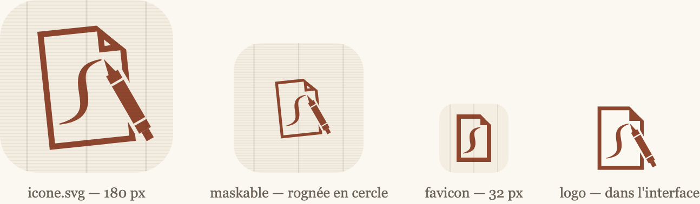

# Icône — texte à donner à Claude Design

Écrit pour : toi, au moment d'ouvrir Claude Design.

La charte générale fait l'objet d'un autre document,
[05 — Charte graphique](05-prompt-charte-graphique.md). Celui-ci ne traite que
de **l'icône** : c'est un travail à part, avec ses propres livrables, et le
mélanger au reste donne des réponses tièdes sur les deux sujets.

---

## L'icône actuelle



Une feuille de papier, son coin replié, un crayon sanguine posé en diagonale,
et le filigrane en volute qui transparaît dans la feuille. Le tout sur un fond
de papier vergé — vergeures serrées, trois pontuseaux.

| | |
|---|---|
| Papier de l'icône | `#F4EEE2` |
| Sanguine | `#8E462F` |
| Trame | `#3D2B1F`, à 6 % (vergeures) et 10 % (pontuseaux) |
| Contraste motif / fond | **5,93 : 1** |

Quatre fichiers dans `resources/icones/`, qui ne servent pas la même chose :

| Fichier | Rôle |
|---|---|
| `icone.svg` | Le dessin complet, plein bord. Écran d'accueil, installation. |
| `icone-maskable.svg` | Le même, motif réduit à 64 % et centré, pour les systèmes qui rognent l'icône en cercle. |
| `favicon.svg` | Une version simplifiée — vergeures retirées, pontuseaux appuyés — qui tient dans 32 pixels. |
| `logo.svg` | Le motif seul, sans fond, cadré serré, repris dans le crème de l'interface. Posé à gauche du mot « Filigrane ». |

---

## Comment refaire ce travail

1. Copier le bloc **« Le texte à copier »** dans Claude Design.
2. Récupérer sa réponse : quatre SVG complets et un tableau de valeurs.
3. Suivre **« Quand tu auras reçu la réponse »**, plus bas.

---

## Le texte à copier

> J'ai besoin de l'**icône** d'une application web installable. Je te demande
> un travail d'icône seul : ni charte complète, ni maquette d'écran.
>
> ### L'application
>
> **Filigrane** est un catalogue privé de dessins anciens. Une collection
> d'environ deux cent cinquante feuilles, photographiées puis décrites une à
> une. Deux utilisateurs : sa propriétaire, qui décrit, et moi, qui
> photographie et entretiens l'application. Elle s'en sert sur un Mac et sur un
> iPhone, où l'application est installée comme une application native.
>
> **Le nom.** Un *filigrane* est la marque laissée dans la pâte du papier au
> moment de sa fabrication, visible par transparence. Les spécialistes du
> dessin ancien s'en servent pour dater et attribuer une feuille. Les motifs
> historiques sont simples : croissant de lune, raisin, licorne, pot, main,
> couronne, cloche. Le papier vergé porte lui-même une trame régulière — des
> **vergeures** serrées et des **pontuseaux** espacés — qui apparaît aussi à
> contre-jour.
>
> **Le registre.** Sobriété de cabinet d'arts graphiques. Papier, encre,
> lumière rasante. Pas de dégradé, pas d'ombre portée, pas de couleur vive.
> L'application montre des reproductions en noir et blanc : son icône n'a pas à
> crier.
>
> ### Où l'icône apparaît
>
> | Contexte | Taille de rendu | Remarque |
> |---|---|---|
> | Écran d'accueil iOS | 180 × 180 px | iOS applique **son propre** masque à coins arrondis |
> | Installation Android / Chrome | 192 et 512 px | variante « maskable » obligatoire, rognée en cercle |
> | Onglet de navigateur | 32 × 32 px et SVG | c'est la taille critique |
> | Logo dans l'application | 36 px de haut, à gauche du mot « Filigrane » en romain, sur fond crème `#FBF8F2` | sans tuile ni fond |
> | Écran de démarrage | couleur de fond unie | tu me dis laquelle |
>
> ### Contraintes techniques
>
> Les PNG sont fabriqués en rendant le SVG **dans un navigateur sans tête**
> (Chromium), puis en capturant l'image. Tu peux donc utiliser tout ce qu'un
> navigateur sait faire : `stroke`, `clipPath`, `mask`, dégradés, opacités.
>
> Trois règles tout de même :
>
> 1. **Un seul `<svg viewBox="0 0 64 64">`**, autonome. Pas de CSS externe, pas
>    de police à charger, pas d'image liée : le fichier doit se suffire.
> 2. **Plein bord, sans coins arrondis.** iOS, Android et les navigateurs
>    appliquent leur propre masque ; un arrondi dessiné à la main en produirait
>    un deuxième.
> 3. **Rien ne dépasse du viewBox.** Vérifie les extrémités des formes
>    tournées : une pointe de crayon à `rotate(60)` sort vite du cadre, et le
>    rendu la coupe sans rien dire.
>
> ### Ce que je te demande de produire
>
> 1. **`icone.svg`** — le dessin complet, prêt à coller dans un fichier.
>
> 2. **`icone-maskable.svg`** — même dessin, **motif réduit à 64 % et centré**,
>    fond plein bord. C'est la variante que les systèmes rognent en cercle :
>    rien d'important ne doit sortir du disque central.
>
> 3. **`favicon.svg`** — la version qui tient dans 32 pixels. Simplifie :
>    enlève ce qui deviendra de la bouillie, appuie ce qui reste.
>
> 4. **`logo.svg`** — le motif seul, sans fond ni tuile, cadré serré, pour être
>    posé à gauche du mot « Filigrane » dans l'interface. Donne-lui un
>    `viewBox` ajusté au dessin et des attributs `width`/`height` au même
>    rapport. Les parties qui sont « du papier » doivent y reprendre le crème
>    de l'interface, `#FBF8F2`, et non celui de l'icône.
>
> 5. **Le tableau des couleurs**, en hexadécimal, avec un nom pour chacune.
>
> 6. **Le contraste mesuré** entre le motif et le fond de l'icône, en rapport
>    (par exemple 5,9 : 1). Je veux au moins **4,5 : 1** pour que le motif
>    tienne à 32 pixels.
>
> 7. **Deux valeurs pour le manifeste** de l'application installable :
>    `theme_color` et `background_color`. Dis-moi laquelle va où et pourquoi.
>
> 8. **Une phrase de justification par choix important** : le motif, la
>    couleur, le cadrage. Pas un paragraphe.
>
> ### Ce qui existe aujourd'hui
>
> Une feuille de papier au coin replié, un crayon sanguine `#8E462F` posé en
> diagonale, un filigrane en volute dans la feuille, sur un fond de papier
> vergé `#F4EEE2`. Tu peux le reprendre, l'améliorer ou l'écarter — dis-moi
> simplement laquelle des trois tu fais.
>
> L'idée à laquelle je tiens, si tu changes de motif : **la trame passe
> par-dessus le dessin**. C'est ce détail qui en fait un filigrane, pris dans
> l'épaisseur de la feuille, et non un dessin posé à sa surface.
>
> ### Ce qu'il faut éviter
>
> - Une tuile sombre : sur un écran d'accueil, elle fait un trou.
> - Un motif qui ne survit pas à 32 pixels.
> - Une couleur saturée : l'application montre des dessins, c'est à eux de
>   porter la couleur.
> - Un dessin qui ne fonctionne qu'en couleur : il doit rester lisible en
>   monochrome.
>
> ### Format de ta réponse
>
> Le code SVG complet entre balises, pas une description. Les valeurs
> hexadécimales dans un tableau. Et, en une ligne chacune, les justifications.

---

## Quand tu auras reçu la réponse

### 1. Les quatre fichiers

Remplace le contenu de `resources/icones/` : `icone.svg`,
`icone-maskable.svg`, `favicon.svg`, `logo.svg`.

> **Retire les métadonnées.** Les fichiers livrés portent un manifeste C2PA de
> près de 8 Ko — plus lourd que le dessin lui-même, et servi à chaque visiteur
> pour le favicon. Supprime le bloc `<metadata>…</metadata>` et l'attribut
> `xmlns:c2pa` de la balise `<svg>`.

Puis :

```bash
make icones     # rend les PNG, recopie les SVG, refait le favicon.ico
make assets     # recompile les feuilles de style
```

### 2. Les couleurs du manifeste

Dans `public/manifest.webmanifest` :

```json
"background_color": "#…",
"theme_color": "#…",
```

Et la même valeur de `theme_color` dans `resources/views/pwa/head.blade.php` :

```html
<meta name="theme-color" content="#…">
```

### 3. Vérifier

```bash
make test       # la suite complète
make captures   # régénère les captures de la documentation
make apercus    # régénère les aperçus de la page publique
```

Puis **regarde les PNG**, pas seulement les SVG :

```bash
open public/icones/icone-180x180.png public/icones/icone-32x32.png
```

Et le logo en situation, à sa taille réelle de 36 pixels : la page de
connexion le montre à côté du mot-symbole.

> **Le piège, c'est le cadrage.** Un dessin dont une forme tournée sort du
> `viewBox` est rogné sans message d'erreur. C'est arrivé au premier
> `logo.svg` livré : le crayon atteignait x ≈ 59,6 pour un cadre qui s'arrêtait
> à 58, et sa pointe était coupée. Deux unités de `viewBox` ont suffi.

### 4. Mettre en ligne

```bash
make deploy
./scripts/verifier-production.sh
```

Le contrôle vérifie que toutes les icônes déclarées dans le manifeste existent
réellement et sont servies comme des images.

---

## Comment les PNG sont fabriqués

`scripts/generer-icones.mjs` rend chaque SVG dans le **Chromium déjà installé
pour les tests**, à la taille exacte voulue, et capture l'image.
`scripts/generer-favicon-ico.php` en tire ensuite le `.ico`, par simple
conversion de pixels.

Ce n'était pas le cas au départ : le rendu passait par ImageMagick, dont le
moteur SVG interne compose mal les transformations imbriquées et **échoue en
silence**. Il plaçait le crayon hors du cadre, sans message ni code d'erreur.
Un navigateur, lui, rend exactement ce que verront les visiteurs — et le dessin
n'a plus à se restreindre aux aplats. Voir
[D-34](04-decisions-et-alternatives.md#d-34).
